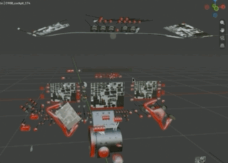
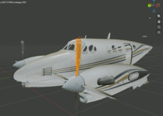

# X-Plane OBJ8 Object — XPlane2Blender's OBJ8 importer

Import [X-Plane OBJ8](https://developer.x-plane.com/article/obj8-file-format-specification/)
`.obj` objects into a Blender scene that [XPlane2Blender](https://github.com/XPlane2Blender/XPlane2Blender)
writes back out — animations, manipulators and lights included.

The import builds the authoring collection itself (see *Handing the scene to
XPlane2Blender*), so **File > Import > X-Plane OBJ8** and then **File > Export >
X-Plane Object (.obj)** is the whole workflow: there is no convert step to
remember, and nothing to set up per file.



One `.obj` in, one XPlane2Blender authoring scene out: a collection, an armature
with the file's animation on its bones, and a material per look.



A real aircraft, not a toy file: Laminar's King Air C90B cockpit/exterior
objects, imported straight from the `.obj` X-Plane ships.

## Install

From [extensions.blender.org](https://extensions.blender.org/add-ons/io_scene_xplane_obj/)
(Preferences > Get Extensions > search "X-Plane OBJ8"), or drag the release
`io_scene_xplane_obj-<version>.zip` into Blender. Requires Blender 4.2 or newer,
and [XPlane2Blender](https://extensions.blender.org/add-ons/io_scene_xplane2blender/)
installed — the export side is its operator.

Menu: **File > Import > X-Plane OBJ8 (.obj)**. Tick "Import whole folder" to
bring in an aircraft's `objects/` directory at once. The export side is
XPlane2Blender's own **File > Export > X-Plane Object (.obj)**; this add-on no
longer needs one of its own.

Dragging an `.obj` from Finder/Explorer onto the 3D Viewport (or onto the
View Layer outliner) imports it too — one file or a multi-selection — because
the add-on registers a file handler for `.obj`.

## What it does

* the import lands **as** the XPlane2Blender collection — one collection, one
  armature, one Action per file, built in place rather than in a preview scene
  that a second pass then rebuilds. There is no preview rig to ignore and no
  leftover collection holding a header;
* one `.obj` becomes one mesh per geometry command, so a 21-part fuselage is 21
  objects you can hide, edit and join;
* `TEXTURE` / `TEXTURE_LIT` / `TEXTURE_NORMAL` become a Principled material
  (base colour, emission, normal map), and the original *relative* texture paths
  (`../../objects/foo/bar.png`) are written back out unchanged;
* the normal map is wired as the **combo map it actually is**, not as a plain
  normal map: `R,G` go into a Normal Map node behind a rebuilt `Z = 1`, the blue
  channel becomes Metallic (metalness mode only, i.e. `NORMAL_METALNESS`), and
  the alpha — gloss — is inverted into Roughness. `TEXTURE_MAP normal` /
  `material_gloss` (XP 12.1) is read the same way from its two files. A
  `TEXTURE_NORMAL` with no `NORMAL_METALNESS` is an XP10/11 file whose RGB is
  the whole vector, so that one stays a plain link;
* a file with **no** `POINT_COUNTS` record (mandatory in the spec, dropped by
  some exporters) imports with a warning that names the sizes used, and the
  record is inserted on the way out — an untouched import stays byte-identical
  apart from that one line;
* a trailing `#` comment on a data or command line (`VT ... # 12`, which
  add-on exporters write and the spec does not mention) is stripped for the
  numbers and kept in the raw line, so a file the sim loads also imports here
  and still writes back byte for byte;
* every `VT` row's authored normal is kept as a custom split normal — X-Plane
  stores lighting normals per vertex and they are not the averaged face normals
  Blender would otherwise compute;
* the command stream (`ANIM_*`, `ATTR_*`, `LIGHT_*`, `ATTR_LOD`, `IF`/`ENDIF`,
  …) is kept verbatim on the collection (`xp8_dump`, `xp8_events`) and replayed
  around the regenerated
  geometry, so moving a vertex does **not** delete the aircraft's door animation;
* the imported scene keeps the file *as text*, so a scene you did not touch is
  written back **byte for byte** by the standalone exporter described further
  down — the XPlane2Blender path rewrites the geometry instead, because it works
  from the object tree and not from a command stream;
* tri / line / light counts and `POINT_COUNTS` are recomputed from what was
  actually written, and `TRIS`/`LINES` offsets are rebuilt with the index table.

Triangle winding is flipped on both sides: X-Plane calls a *clockwise* triangle
the front face, Blender a counter-clockwise one. Forgetting this makes every
model render inside-out — no error, just invisible surfaces.

## Animation

A `.obj` animation is driven by a **dataref** — a value the sim owns at run time
(`sim/flightmodel2/gear/deploy_ratio[0]`), not by a clock. Blender has no such
input, so the time line *is* the dataref:

* every batch inside an `ANIM_begin`/`ANIM_end` block gets a **chain of rig
  Empties** (`header -> rig -> rig -> mesh`), one per transform command, holding
  the transform its dataref selects. The part therefore sits where the sim would
  draw it — gear legs down, doors open — instead of piled up at the file origin,
  and you can edit it there. A compound animation (a pitch translate, then a
  yoke-hide, then a roll rotate) is a chain, so each dataref keeps its own
  values and its own keys instead of being squashed into one;
* **the file becomes one armature, bone for bone.** The `ANIM_begin` blocks are
  a hierarchy (a translate, a hide, a show, a pivot plus a roll around one yoke),
  so the importer builds **one armature for the whole `.obj`**, its bone tree a
  copy of the block tree, one bone per transform command, named after its block
  (`b181_1`). A batch hangs off the bone of its innermost block, so parts that
  share a block share a bone. One command keeps its Empty — a hinge does not
  need a rig. OBJ8 has no skinning, so **no Armature modifier is added**: the
  bones move the batch, the vertices stay the file's own, and an untouched round
  trip is still byte identical;
* **every bone is `AXIS_ANGLE`.** An `ANIM_rotate_begin <x> <y> <z> <dataref>` is
  an axis plus a keyed angle, so that is what the bone stores: the angle channel
  carries the file's own degrees (one key per file key, no subdivision, and a
  1200° trim wheel keeps turning instead of being folded to −120° by a
  quaternion's short arc) and the axis channel carries the file's own axis as
  `xp8_axis`. The degree is also keyed into `xp8_angle_deg`, so a
  `ANIM_rotate_key 1 53.690156` can be read as 53.690156 in the bone panel;
* each rig also gets an **Action** with **one keyframe per key the file has**,
  **key N on frame N** — a two-endpoint `ANIM_rotate` becomes two keyframes,
  a 15-key gauge table fifteen. That is XPlane2Blender's convention too (its
  export samples the pose at the frames the dataref keys sit on), so a scene
  authored here and one authored there agree about which frame means which
  state, and a three-key table stays three frames wide instead of being smeared
  over a hundred. Index, not dataref value:
  real gauges key on things like `-9999, 0, 0.0126, 0.0252, …, 9999`, and a
  value-linear time line squeezes all twenty keys into two adjacent frames where
  they collapse into one. Linear keys, because that is how the file
  interpolates; a rotation of more than 180° between two keys gets the one
  intermediate key Blender needs to replay the long way round;
* `ANIM_show`/`ANIM_hide` stay **text** and are written back as they came in
  (they live in `xp8_anim_vis` on the batch).  Nothing in the scene is hidden
  and nothing is keyframed: a dataref is not a clock, so a `hide_viewport`
  keyframe only invented a schedule — it hid parts the user then could not find
  again, and XPlane2Blender reads that same flag as "export the animation only"
  and drops the geometry without a word.

**Import** options: *Animation at* (0..1, where to look — the pose you edit in),
*Pin datarefs* (`dref=value, …` to hold one still while the rest sweeps, e.g. a
prop at 0°, and *Bake Actions* off for rigs with a static pose only).

**Export** has two animation modes:

| mode | what happens |
| --- | --- |
| **From the file** (default) | the `ANIM_*` command stream is written exactly as imported. Edit it as text in `xp8_events` |
| **From Blender (rigs)** | every animated batch's block is **regenerated from its rig's Action**: the keyframes become `ANIM_rotate_begin`/`ANIM_rotate_key` tables (and `ANIM_trans_*`), and the file's own animation commands are dropped |

Rigs never reach the file — the exporter walks the parent chain, skips them, and
uses what you set on the mesh itself — so an untouched import is still byte
identical, and a part you *move* in Blender exports at the new position.

Drag the time line to watch the gear retract, the altimeter needle sweep, the
yoke move in pitch and roll at once.

To *author* a new animation, select a batch and press **Animate Part** in the
N-panel (category *X-Plane*): it creates the rig. Keyframe the rig's
location/rotation, export with **From Blender (rigs)**.

### The dataref is a field, not hidden data

Select a rig and the panel shows the animation in three editable controls:

| control | what it does |
| --- | --- |
| **Dataref** | the sim variable that drives the part — type any name, or use *Pick a dataref from this object* to choose one the file already uses. Changing it renames what the exported `ANIM_rotate_key` table is keyed on (a `show`/`hide` that watched the old name follows) |
| **Value@1 / @last key** | the dataref values at the first and last key of the table, i.e. what the keys' x values mean. `0..1` for a ratio, `-18..89` for prop pitch |
| **Drop the show/hide rules** | the `ANIM_show`/`ANIM_hide` ranges this part carries; dropping them makes the part drawn at every value |

All three are plain custom properties (`xp8_dataref`, `xp8_value_min`,
`xp8_value_max`, `xp8_anim_vis`), so they are also visible in the object's
*Custom Properties* list and survive a save. Nothing about the animation is
hidden in a file you cannot reach — the only thing that comes from elsewhere is
the keyframe *count*, which follows the file's own keys at import.

A rotation is written as one `ANIM_rotate_begin` axis/angle table — exactly the
shape a hinge has — preceded by an `ANIM_rotate` for the rest orientation when
the part is not built axis-aligned. **A batch is only re-keyed when it really is
one hinge driven by one dataref**; OBJ8's key table has a single x axis, so
anything else (a gear leg that folds *and* steers, a wiper arm and blade on two
datarefs) would silently lose one of its inputs. Those batches keep the
animation they came in with, and the export says so, part by part, in the
console — an edit made to them in Blender is not written.

## Export writes the selection

> **Legacy path.** Everything from here to *Where the X-Plane data lives* is the
> add-on's own exporter. The supported export path is XPlane2Blender's, and the
> import has already rebuilt the scene for it; keep reading only if you want the
> standalone writer (byte-identical write-back, or a `.patch.obj` for Ortho4XP).

**File > Export > X-Plane OBJ8** writes what is selected, nothing else:

| selection | what the file gets |
| --- | --- |
| the header Empty — the object itself | every part; byte for byte when nothing was edited |
| one or more mesh parts | only those parts' geometry |
| nothing | the whole scene: one imported object → that object, byte for byte; several → all meshes flattened into one file (command streams dropped, with a warning) |
| objects of several files at once | one file (the active object's); the others are skipped with a warning |

A partial export keeps the file's **command stream** — `ANIM_*`, `ATTR_manip_*`,
`ATTR_LOD`, `LIGHT_*`, `TEXTURE`/`GLOBAL_*`, the `VLINE`/`VLIGHT` sections — so
animations and manipulators survive; the dropped parts simply contribute no
batch, the `VT` and index tables are rebuilt from the parts that were written,
and `POINT_COUNTS` is recomputed to match. An `ATTR_LOD` level whose only
geometry was dropped stays behind as an empty level; if X-Plane complains,
remove the leftover lines from `xp8_events` on the header Empty.

A subset is never the original text, so the byte-identical shortcut is off
while parts are left out, and the dialog proposes `<name>_selected.obj` rather
than the source path — a partial write must not overwrite the object it came
from. **Back to source files** and the `.patch.obj` sibling follow the same
selection.

## Ortho4XP mesh patches

Tick **Write .patch.obj** on the export dialog and a sibling file is written next to the
`.obj`: `<name>.patch.obj`, the form Ortho4XP reads as a *terrain patch*
(`O4_Vector_Map.keep_obj8`, step 1). One `.obj` in, two files out.

| | `<name>.obj` | `<name>.patch.obj` |
|---|---|---|
| header block `I / 800 / OBJ` | yes | no |
| `ANCHOR` | no | line 1 |
| contents | globals, commands, animation | `VT` + `IDX10`/`IDX` + `TRIS` only |
| read by | X-Plane | Ortho4XP |

`ANCHOR` is not part of the X-Plane OBJ8 format (the spec puts an object's 0,0,0 wherever the
scenery places it), and Ortho4XP needs it on line 1 — so the two forms cannot be one file.

* The **longitude/latitude** is taken from the Ortho4XP tile in the scene: an import with the
  *X-Plane DSF and Ortho4XP Mesh* add-on leaves `mesh_georef` on its object, and the anchor is
  that frame's origin (the tile centre). Both are written as the frame's `lon0`/`lat0`, so the
  patch's `VT` columns are the object's own metres, unchanged.
* **Altitude and heading are 0.** Height therefore comes straight from the `VT` heights
  (absolute metres), and the axes are not rotated.
* No tile in the scene: the export still writes the normal `.obj` and reports a warning, the
  `.patch.obj` is skipped.

Drop the patch into `Patches/<lat tens><lon tens>/<+LL+LLL>/<any folder>/` and rebuild steps
1–2 of the tile. It contributes geometry and height only: no texture, no UV, and vertical faces
collapse, because the mesh is a height field. A patch belongs on a *scenery* object — an
aircraft's geometry exported this way would put the whole aircraft into the terrain.

## Where the X-Plane data lives

One `.obj` becomes one header Empty plus one mesh per geometry command. The
header carries the file as **text** in custom properties (the ground truth the
standalone exporter writes back), and the animation you edit is the
XPlane2Blender armature: one bone per ANIM block, keyed from the file's own key
tables. Nothing you do to the meshes can damage the text.

| property | on | contents |
| --- | --- | --- |
| `xp8_dump` | Empty | the whole original file, for the byte-identical write-back |
| `xp8_events` | Empty | ordered command stream: `["A"]` ANIM_begin, `["Z"]` ANIM_end, `["R", line]` any command line verbatim, `["L", n]` geometry batch `n` |
| `xp8_globals` | Empty | `TEXTURE` / `POINT_COUNTS` / `GLOBAL_*` lines |
| `xp8_leaf_states` | Empty | the `ATTR_*` snapshot each batch draws under |
| `xp8_leaf_objs` | Empty | batch index → object name |
| `xp8_fingerprints`, `xp8_cmd_hash` | Empty | what the "was anything changed?" test compares |
| `xp8_leaf` | mesh | which batch it is |
| `xp8_anim_vis` | mesh | the `ANIM_show/hide` rules of its block, in file order |
| `xp8_dataref`, `xp8_anim_range`, `xp8_anim_datarefs`, `xp8_anim_action`, `xp8_anim_keys` | rig Empty | only built by `import_file(preview_rig=True)` — the preview rig the verify scripts use; the UI import goes straight to XPlane2Blender's armature |
| `xp8_placement` | mesh | legacy: a static `ANIM_trans` offset, still honoured on export |
| `xp8_vt` | mesh attribute | source `VT` row index per vertex, so untouched rows keep their exact text |

Editing `xp8_events`, `xp8_globals` or `xp8_leaf_states` and exporting does reach
the file: the untouched-file shortcut switches itself off as soon as any of them,
or any geometry, differs from what was imported.

## Handing the scene to XPlane2Blender

The model above is for *editing an existing file*: the command stream is kept
verbatim and written back around your geometry, which is why an untouched file
is byte-identical.  XPlane2Blender works the other way round - it rebuilds every
`ANIM_*` block from the object tree - so it has no way to echo raw commands and
is the wrong tool for that job.

What it *is* the right tool for is authoring: manipulators, new animations,
lights, LODs.  The import runs the one-way bridge (`object.xp8_to_xp2b`, also on
the N-panel as *author with XPlane2Blender*) as its last step, so the exportable
collection exists the moment the file lands.  It builds it next to the imported
objects:

| in the file | in the XPlane2Blender collection |
|---|---|
| `ANIM_begin/end` nesting | a chain of Empties, or a bone chain when the subtree is a pure dataref cascade (see below) |
| `ANIM_trans_begin` + keys | an Empty with a `transform` dataref and one location key per file key |
| `ANIM_rotate_begin` + keys | an Empty with `rotation_mode = AXIS_ANGLE` (the file's axis, verbatim) |
| static `ANIM_trans` / `ANIM_rotate` | plain Empty transforms |
| `ANIM_show` / `ANIM_hide` | `show` / `hide` datarefs with the file's range |
| `ATTR_draw_disable` | a material copy with *Draw Objects With This Material* off |
| `ATTR_light_level` | the material's light-level fields |
| `ATTR_cockpit*` | the material's *Cockpit Feature* (`Panel Texture` / `Cockpit Device`, or none) plus the layer's *Panel Texture Mode*; `COCKPIT_REGION` becomes the layer's region table |
| `ATTR_manip_*` | `object.xplane.manip` (command family, toggle, push, radio, delta/wrap, drag axis) |

Material clones are shared: batches that ask for the same state combination get
one clone, not one each (a cockpit that would land 163 materials lands 5).

The bridge does not copy the scene: it re-parents the imported meshes onto its
own armature and swaps in `_nodraw` / `_cam` material clones, so after an import
the scene belongs to XPlane2Blender and the standalone exporter no longer
reproduces the file.  That is the trade this path makes — the byte-identical
write-back is an *import-time* capability, not something to do afterwards.
The conversion is lossy in a known way and says so: `LIGHT_*` primitives,
`ATTR_LOD`, `IF/ENDIF` and `MAGNET` cannot be handed to XPlane2Blender as
commands, so they are dropped with a warning per file (the counts are also
stored on the new collection as `xp2b_convert_warnings`).

**One armature, and `ANIM_show/hide` on the batches.** The bridge builds the same
single armature as the importer, from the same block tree, so a part that shares
a block shares a bone (King Air C90B cockpit: 1 armature, 289 bones, 142 batches,
where the previous cut made 134 armatures out of the same file).

XPlane2Blender only writes `ANIM_show/hide` for an *object*, and a bone cannot
hang under one, so those rules are written onto **every batch the block covers**
instead of onto a host Empty: outermost block first, innermost last, which is the
order X-Plane reads them in (the innermost command wins - that is how
`ANIM_hide 0 0` wrapping a per-part `ANIM_show 1 1` works).  Nothing is left on
an Empty, so the bone chain is never interrupted.

Measured through XPlane2Blender on four aircraft objects and the fixture: every
batch lands within 0.07 m of the file at five dataref positions, most exactly.

Measured on Laminar's C90B exterior: `ANIM_*`/`ATTR_*` text comes out
line-for-line identical apart from 1e-4-level float rounding, triangle counts
are exact (fuselage 19697, lights 1558), and one block that carries both a
translation and a rotation table comes out as two nested `ANIM_begin` blocks -
same composition order, same result.

## Known limits

* `LINES` are imported read-only and exported from their stored indices; light
  primitives (`LIGHT_PARAM`, `LIGHT_NAMED`) are preserved as raw commands.
* Animation can be *re-keyed* here (rigs + Actions → `ANIM_rotate_key` tables),
  but only as a rigid transform per batch: rotation is written as Euler XYZ
  around the origin, and `ANIM_show`/`ANIM_hide` are carried through as-is
  rather than authored. Manipulators (`ATTR_manip_*`) survive an export but
  cannot be created or edited here — use
  [XPlane2Blender](https://github.com/X-Plane/XPlane2Blender) for that.
* One `.obj` has one texture set, so an object with several materials exports
  with the first material's textures.
* Blender stores custom normals as int16 per axis, so regenerated normals can
  differ from the source by ~1e-4. Positions and UVs round-trip exactly.
* The bridge is not exact on every file. King Air C90B `C90B_cockpit.obj` lands
  up to 0.48 m off on 7 of 358 batches and MD-82 `gear_main.obj` up to 23.8 m;
  both numbers are **identical** on the code from before the bone work (checked
  by exporting the same file from `a398892`, whose scene had 134 armatures), so
  this is a pre-existing gap in the `ANIM_*` → XPlane2Blender conversion and not
  the bone tree. Re-export such a file from XP2B by hand until it is chased down.
* A bone-rigged batch is **preview**: *From Blender (rigs)* samples the rig
  Empties, one key table each, so a cascade that lives on a bone chain keeps the
  animation the file came in with instead of being re-keyed from Blender. The
  export says how many batches that was. Editing such a part's geometry still
  exports; editing its motion needs the `ANIM_*` text in `xp8_events`.

## Development

```sh
./dev-link.sh            # symlink this repo into Blender's user extension folder
                         # then enable "X-Plane OBJ8 Object" in Preferences

python3 verify/test_codec.py verify/fixtures       # codec only, no Blender
python3 verify/test_fixture.py                     # pinned expectations
python3 verify/test_anim.py                        # ANIM_* evaluator, no Blender
blender -b --factory-startup --python verify/roundtrip_blender.py -- verify/fixtures
blender -b --factory-startup --python verify/anim_roundtrip.py -- verify/fixtures
blender -b --factory-startup --python verify/check_selection.py   # export = selection
blender -b --factory-startup --python verify/check_bones.py -- <file.obj>       # nested animation -> bones
blender -b --factory-startup --python verify/check_bones_xp2b.py -- <file.obj>  # ... and out through XP2B
blender -b --factory-startup --python verify/check_cockpit.py -- <file.obj>     # ATTR_cockpit* -> cockpit feature, and back

# stronger: run the same tests against a real aircraft
blender -b --factory-startup --python verify/roundtrip_blender.py -- \
    "/path/to/X-Plane 12/Aircraft/<plane>/objects/<folder>"
```

`objcodec.py` is pure Python (no `bpy`), so the format work can be tested and
debugged without starting Blender.

## Releasing

1. bump `version` in `blender_manifest.toml`
2. `git tag -a v<same version>` (annotated: its message becomes the release
   notes) and `git push origin main v<same version>`

The `v*` tag runs `.github/workflows/blender-extension.yml`, which builds
`io_scene_xplane_obj-<version>.zip` with `blender --command extension build`,
validates it, keeps it as the `blender-extension` build artifact and attaches it
to a **draft** GitHub release. Nothing is published automatically: review the
draft and publish it if you want it on GitHub, then send the same zip to
<https://extensions.blender.org/submit/>, where it appears once the moderation
team approves it.


What ends up in the zip is decided by `[build] paths_exclude_pattern` in the
manifest: the add-on modules, `LICENSE` and this README. The test fixtures, the
dev symlink helper and the CI config stay in the repository.

Tests are not part of the release build — run them yourself:

```sh
python3 verify/test_codec.py verify/fixtures
python3 verify/test_fixture.py
python3 verify/test_anim.py
blender -b --factory-startup --python verify/roundtrip_blender.py -- verify/fixtures
blender -b --factory-startup --python verify/anim_roundtrip.py -- verify/fixtures
```


## License

GPL-3.0-or-later, matching the [extension platform requirements](https://docs.blender.org/manual/en/latest/advanced/extensions/licenses.html).
