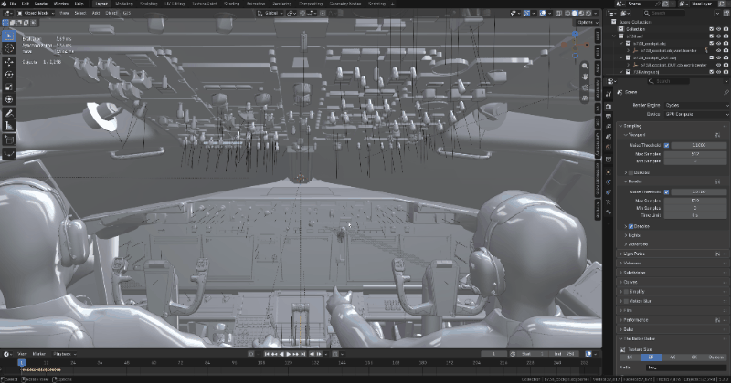

# io_scene_xplane_obj

X-Plane aircraft (`.acf`) and OBJ8 objects, opened in Blender — rig, lights and
textures intact — and exported again through XPlane2Blender in the same install.

## Features

| | in Blender | on export |
| --- | --- | --- |
| **Animation** | one armature per file, one bone per `ANIM_rotate` / `ANIM_trans` command, the bone tree a copy of the block tree; key N sits on frame N, and every bone is `AXIS_ANGLE` with the file's own axis and degrees — a 1200° trim wheel keeps turning instead of being folded to −120° | XPlane2Blender rebuilds every `ANIM_*` block from the object tree |
| **Lights** | one Blender point light per `LIGHT_PARAM` / `LIGHT_NAMED` line, at that line's position, the parameter text kept verbatim in XP2B's light data; a light inside an `ANIM_` block rides that block's bone, so a nav light follows the rudder | the light object's own XP2B light settings |
| **Particles** | `PARTICLE_SYSTEM` becomes the layer's particle file, every `EMITTER` an Empty with XP2B's *Particle Emitter* type — name, array index, position, Euler angles | that layer's emitter table |
| **PBR textures** | X-Plane's normal map is a *combo* map and is decoded: `R,G` → normal with `Z` rebuilt as 1, `B` → metalness in `NORMAL_METALNESS` mode, `A` → gloss inverted into roughness; `TEXTURE_MAP normal` / `material_gloss` / `gloss` (12.1) read the same way, images set Non-Color | the layer's Default / Night / Normal-Specular fields, and on 12.0+ Normal / Material-Gloss / Gloss, *Normal Metalness* and *Blend Glass* |

Also on the trip: geometry with its authored per-vertex normals (not averaged),
UVs exact, one mesh per geometry command; all manipulator families
(`ATTR_manip_drag_axis` … `_axis_switch`, detents included) as editable XP2B
manipulator settings; cockpit panels and devices (`ATTR_cockpit*`,
`COCKPIT_REGION`, panel texture mode); `ATTR_light_level` as the object's override
light level; `ATTR_LOD`, `ATTR_draw_disable`, culling, `ATTR_solid_camera`,
`ATTR_shiny_rat`. A whole aircraft comes in from its `.acf` — every attached
`objects/*.obj` as one collection under the aircraft's name (Laminar C172: 42 of
42 found).

## Animation

*Laminar's King Air C90B: one collection per `.obj`, one bone per `ANIM_` block,
and each bone moves only the batches that hung off it.*

A `.obj` animation is driven by a **dataref** — a value the sim owns at run time
(`sim/flightmodel2/gear/deploy_ratio[0]`) — not by a clock. Blender has no such
input, so in the imported scene the time line *is* the dataref: a two-endpoint
`ANIM_rotate` is two keyframes, a 15-key gauge table fifteen, and the index is
kept, not the value (gauges key on `-9999 … 9999`, and a value-linear time line
would squeeze twenty keys into two adjacent frames).

OBJ8 has no skinning, so no Armature modifier is added — the bone moves the
batch, the vertices stay the file's own. From there it is a normal armature:
re-time it, mirror a motion, drive it from a different dataref, or add a control
that was never in the file.

A selected batch shows what drives it: **Dataref**, **Value@1 / @last key** (what
the keys' x values mean), and the `ANIM_show` / `ANIM_hide` rules it carries. All
three are plain custom properties (`xp8_dataref`, `xp8_value_min`/`xp8_value_max`,
`xp8_anim_vis`), visible in *Custom Properties*, saved with the blend.

Show/hide stays text and reaches the export unchanged (`xp8_anim_vis` on the
batch): a dataref is not a clock, so a `hide_viewport` keyframe only invents a
schedule — and XP2B reads that flag as "export the animation only" and drops the
geometry.

**One exception, on purpose:** a batch is only re-keyed when it really is one
hinge on one dataref. A gear leg that both folds and steers, or a wiper arm and
blade on two datarefs, would silently lose one input, so those batches keep the
animation they came in with and the export names them part by part.

## Lights

Every `LIGHT_PARAM` and `LIGHT_NAMED` line becomes a light object whose position
is the line's position and whose XP2B data holds the rest of the line verbatim —
each light name has its own parameter list, so nothing is parsed into fields. The
nesting is kept too: a light written inside an `ANIM_` block is parented to that
block's bone, because otherwise a nav light driven by
`sim/flightmodel2/wing/rudder1_deg` stops following the rudder after export.

A `LIGHT_PARAM` with no parameters is reported and left unconverted: X-Plane
accepts it, XPlane2Blender cancels the whole export over an empty parameter box.

`ATTR_light_level` lands on the **object**, not a material clone (XP2B emits the
level when the material changes and does not re-emit it for a later batch that
shares the value — on `C90B_cockpit.obj` that silently dropped
`laminar/c90/warning/gear_handle` from 21 of 33 batches).

## Particles

`PARTICLE_SYSTEM` fills the layer's *Particle System File*, and each `EMITTER`
becomes an Empty carrying XP2B's emitter type, name, array index, position and
Euler angles.

Particles are **referenced, not authored**: the `.pss` itself is neither read nor
written — shape, size and lifetime curves stay in that file, edited with Laminar's
particle editor. An emitter is only converted where XP2B can write one: the layer
needs a `.pss` and the scene's X-Plane version must be 11.30 or later
(*Scene > X-Plane > Version*). Otherwise the emitters are reported and left out
rather than handed to the exporter and cancelling the export.

## Textures

X-Plane packs the whole material into one image, so linking it straight into
Blender is wrong the moment there is more than a normal in it. The import wires
the channels apart in the material graph: normal from `R,G` with `Z` rebuilt,
metalness from `B`, roughness from inverted `A` — because a `Z` fed from a channel
that holds material data lights every surface inside-out. A `TEXTURE_NORMAL`
without `NORMAL_METALNESS` is an XP10/11 file whose RGB is the complete vector and
whose alpha is specular strength, so that one keeps a plain image → Normal Map
link.

Texture **paths live on the layer** (Collection > X-Plane > Textures), not the
material — XP2B does not read node trees, so those fields are what exports. They
are stored the way the file spells them (`livery_NML.png`), so a file kept next to
its textures exports with the same one-word name.

One `.obj` has one texture set, so an object with several materials exports with
the first material's textures. Material clones are shared per state combination
(a cockpit that would otherwise land 163 materials lands 5).

## What people do with it

* **Recover the rig of a shipped aircraft.** A `.acf` plus baked `.obj` files is
  all there is; this turns it back into collections, armatures, materials and a
  control panel you can edit.
* **Fix a legacy aircraft.** A dataref changed and a lever moves the wrong way, a
  hinge is 2 cm off, a panel lost its gloss, a freeware model X-Plane 12 will not
  light properly.
* **Reuse a cockpit instead of modelling one.** Import, re-texture, re-export into
  your own aircraft.
* **Keep a project maintainable.** One collection per file, one mesh per part,
  animations as armatures, and an exporter on the other side.

## Install

1. **Preferences > Get Extensions**, search **X-Plane OBJ8**, install, restart
   Blender once.
2. Drag a **`.acf`** (whole aircraft) or `.obj` files onto the viewport, or use
   **File > Import** — *Import whole folder* brings in a whole `objects/` directory.
3. Edit, then **File > Export > X-Plane Object (.obj)**. Export is
   XPlane2Blender's own operator, bundled as a wheel: nothing here writes a `.obj`
   itself, so authoring manipulators, new animations, lights and LODs works exactly
   as it does upstream.

Blender 5.0 or newer. The import lands as an XPlane2Blender authoring scene in one
step — there is no separate convert step, and no second add-on to keep in step.

## Limits

| | |
| --- | --- |
| the `.acf` is never written | read only, as Laminar asks; changes go into the `.obj` files |
| per-object attach offsets are not applied | every part arrives at its own origin, as if you had opened each `.obj` by hand |
| `LINES` / `VLINE` | imported read-only, exported from their stored indices |
| `.pss` | referenced by name only, never read or written |
| mixed cockpit panel modes | XP2B's layer holds one panel texture mode, so the first wins and the mixture is reported |
| `ATTR_manip_device` (TDS GTN750Xi and friends) | third-party extension, no XP2B counterpart; reported, not converted |
| drag-rotate manipulator that disagrees with its bones | carried verbatim as a raw custom attribute instead of editable N-panel fields |
| custom normals | Blender stores int16 per axis, so regenerated normals can differ by ~1e-4; positions and UVs round-trip exactly |
| bridge accuracy | `C90B_cockpit.obj` up to 0.48 m off on 7 of 358 batches, MD-82 `gear_main.obj` up to 23.8 m — a pre-existing gap in the `ANIM_*` → XP2B conversion, unchanged by the bone work |
| disabling the add-on with an aircraft open | the scene's animation lives in XP2B's own property groups; the add-on restores them a tick later, but restart Blender after a deliberate disable |

Tested on Laminar's Cessna 172 (42 objects from its `.acf`), Boeing 737-800 and
Airbus A330 cockpits, plus add-on aircraft such as the King Air C90B. The numbers
behind the accuracy claim are in
[known limits](https://github.com/cpuwolf/io_scene_xplane_obj/blob/main/docs/known-limits.md).

## Docs

| | |
| --- | --- |
| [install](https://github.com/cpuwolf/io_scene_xplane_obj/blob/main/docs/install.md) | requirements, checking it worked, uninstall |
| [import](https://github.com/cpuwolf/io_scene_xplane_obj/blob/main/docs/import.md) | what the import builds, combo maps, tolerant parsing |
| [animation](https://github.com/cpuwolf/io_scene_xplane_obj/blob/main/docs/animation.md) | the armature, keys, `ANIM_show/hide`, the dataref panel |
| [export bridge](https://github.com/cpuwolf/io_scene_xplane_obj/blob/main/docs/xp2b-bridge.md) | what maps to what, and the exceptions worth knowing |
| [known limits](https://github.com/cpuwolf/io_scene_xplane_obj/blob/main/docs/known-limits.md) | what is not carried, and how accurate the bridge is |
| [credits](https://github.com/cpuwolf/io_scene_xplane_obj/blob/main/CREDITS.md) | the bundled exporter: authors, licence, what was changed |
| [development](https://github.com/cpuwolf/io_scene_xplane_obj/blob/main/docs/development.md) | dev link, tests, releasing |

## License

GPL-3.0-or-later, matching the
[extension platform requirements](https://docs.blender.org/manual/en/latest/advanced/extensions/licenses.html).
The exporter inside this package is XPlane2Blender's armature build; its authors
and licence are credited in [CREDITS.md](https://github.com/cpuwolf/io_scene_xplane_obj/blob/main/CREDITS.md).

Not affiliated with Laminar Research. Use it on aircraft you have the right
to modify.
